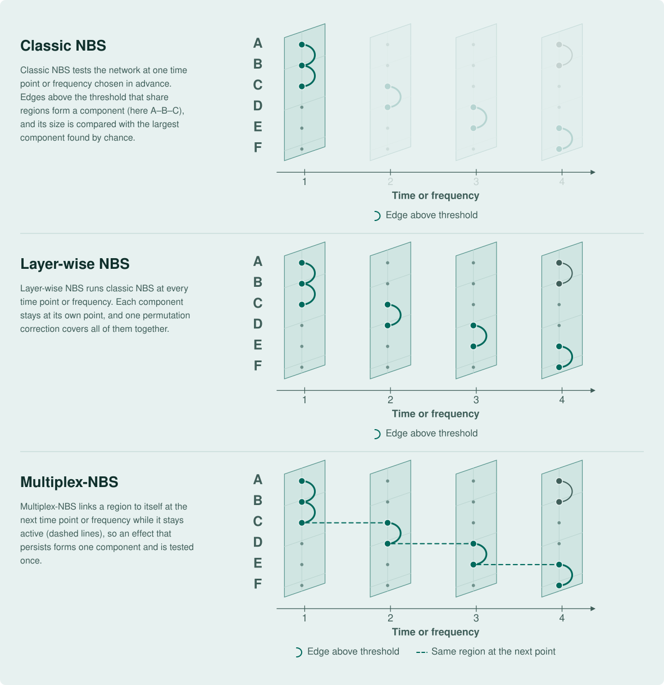
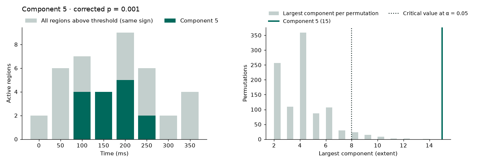

# Multiplex-NBS

**Network-based statistics for one network or a stack of networks** measured at
successive time points, frequency bins or other ordered layers — as a desktop app, a
Python package and a MATLAB toolbox.

[](https://github.com/Minarose/multiplex-nbs/actions/workflows/tests.yml)
[](LICENSE)


The network-based statistic (NBS; Zalesky et al., 2010) finds connected sets of edges
that differ between groups or conditions and controls the family-wise error rate with
permutations. Multiplex-NBS keeps that logic and adds the layer axis: the same network
measured at successive time points or frequencies.

<picture>
  <source media="(prefers-color-scheme: dark)" srcset="docs/images/methods-overview-dark.svg">
  
</picture>

| Method | What counts as connected | Use when |
|---|---|---|
| **Classic NBS** | Edges sharing regions, in one network (or one layer chosen in advance) | You test a single network |
| **Layer-wise NBS** | As classic, separately in every layer; one correction across all layers | You want to know which layers show an effect |
| **Multiplex-NBS** | Also a region with itself in the next layer, so a component can span layers | An effect may persist across time or frequency |

## Desktop app (no programming)

**Mac:** install from Terminal (Applications → Utilities → Terminal). The app is not yet
signed by Apple, so macOS blocks it when it is downloaded with a web browser; this command
downloads it, moves it to Applications and opens it. On a Mac with Apple silicon
(M1 or later, macOS 14+):

```bash
cd ~/Downloads && \
curl -LO https://github.com/Minarose/multiplex-nbs/releases/download/v0.1.0/Multiplex-NBS-0.1.0-macOS-arm64.zip && \
ditto -x -k Multiplex-NBS-0.1.0-macOS-arm64.zip Multiplex-NBS && \
mv Multiplex-NBS/MultiplexNBS.app /Applications/ && \
rm -rf Multiplex-NBS Multiplex-NBS-0.1.0-macOS-arm64.zip && \
open /Applications/MultiplexNBS.app
```

On a Mac with an Intel processor (macOS 11+), use `macOS-x86_64` in place of
`macOS-arm64` (three times). The [app guide](docs/app-guide.md#install) has both commands.

**Windows 10 or 11 (64-bit):** download `Multiplex-NBS-0.1.0-Windows-x86_64.zip` from the
[release page](https://github.com/Minarose/multiplex-nbs/releases/tag/v0.1.0), extract it
and open **MultiplexNBS.exe**; if *Windows protected your PC* appears, choose
**More info → Run anyway**.

**In a browser:** [minarose.github.io/multiplex-nbs](https://minarose.github.io/multiplex-nbs/)
runs the same analysis with nothing to install. It suits trying the app and small to
moderate datasets; a browser tab has limited memory and one processor core, so use the
desktop app or Python for large studies.

Everything runs on your computer; nothing is uploaded. See the [app guide](docs/app-guide.md).

## Python

```bash
pip install "multiplex-nbs[plot] @ git+https://github.com/Minarose/multiplex-nbs"
```

```python
from multiplex_nbs import load_demo, multiplex_nbs, components, report

data = load_demo("brain-network")              # or load_dataset("study.npz") / make_dataset(W, group, ...)
result = multiplex_nbs(data, threshold=3.0, n_perm=5000, seed=1)

for c in components(result, significant_only=True):
    print(c["id"], c["p_fwe"], c["regions"], c["axis_values"])
print(result["methods"])                         # a methods paragraph to adapt for a paper
```



Also `layerwise_nbs`, `classic_nbs`, `save_results` (`.json`, `.csv`, `.mat`, `.txt`)
and figures (`plot_layer_profile`, `plot_membership`, `plot_null_distribution`). From a
terminal: `multiplex-nbs run study.npz --output result.json`, or `multiplex-nbs` to open
the app. Every function is documented: `help(multiplex_nbs.nbs)` or the
[Python API](docs/python-api.md). Worked [examples](examples/python).

## MATLAB

Download or clone the repository, then:

```matlab
addpath('multiplex-nbs/matlab')
mnbs_selftest                                    % check the installation once

d = mnbs_load_demo('brain-network');
opts = struct('t0', 3, 'nPerm', 5000, 'axisName', d.axisName, ...
              'axisUnit', d.axisUnit, 'axisValues', d.axisValues);
result = mnbs_analyze(d.W, d.group, opts);       % Multiplex-NBS
disp(result.significant)
```

`opts.layerAdjacency = 'independent'` gives layer-wise NBS; pass `model` (`X`, `C`,
`statType`) instead of `group` for a GLM. `help Contents` lists every function and
`mnbs_gui` opens an interactive window. See the [MATLAB API](docs/matlab-api.md) and
[examples](examples/matlab). Base MATLAB R2021a or newer; no other toolbox needed.

## Your data

One undirected connectivity matrix per participant (regions × regions), or one per
layer, with the same regions in the same order for everyone, plus group labels, pair
IDs or a design matrix. Load a single `.npz`/`.mat` file, or one ZIP of participant
files per group. See [Data format](docs/data-format.md).

## Documentation

[App guide](docs/app-guide.md) · [Data format](docs/data-format.md) ·
[Interpreting results](docs/interpreting-results.md) · [Python API](docs/python-api.md) ·
[MATLAB API](docs/matlab-api.md) · [Method](docs/method.md) ·
[Classic NBS parity](docs/classic-nbs-parity.md) · [Validation](docs/validation.md) ·
[Limitations](docs/limitations.md) · [Security and privacy](docs/security-and-privacy.md)

A corrected p-value applies to a **component as a whole**, not to its individual edges,
regions or layers. Choose the method, threshold and component measure before looking at
results. See [Interpreting results](docs/interpreting-results.md).

## Citing

If you use Multiplex-NBS, please cite the software ([CITATION.cff](CITATION.cff); GitHub's
**Cite this repository** button gives APA and BibTeX) and the original method:

> Zalesky A, Fornito A, Bullmore ET (2010). Network-based statistic: identifying
> differences in brain networks. *NeuroImage* 53:1197–1207.
> doi:10.1016/j.neuroimage.2010.06.041

The permutation framework behind NBS and Multiplex-NBS is described in:

> Nichols TE, Holmes AP (2002). Nonparametric permutation tests for functional
> neuroimaging: a primer with examples. *Human Brain Mapping* 15:1–25.
> doi:10.1002/hbm.1058
>
> Maris E, Oostenveld R (2007). Nonparametric statistical testing of EEG- and
> MEG-data. *Journal of Neuroscience Methods* 164:177–190.
> doi:10.1016/j.jneumeth.2007.03.024

## Authors

Minarose M. Ismail, Brady J. Williamson and Darren S. Kadis. Multiplex-NBS develops
Darren S. Kadis's March 2026 MATLAB prototype; see [Contributors](docs/contributors.md).

## Licence

Multiplex-NBS is free software under the [GNU General Public License v3](LICENSE) or
later. The brain demo uses an openly licensed (CC BY 4.0) structural connectome; see
[Demo data](docs/demo-data.md). Questions and bug reports:
[issues](https://github.com/Minarose/multiplex-nbs/issues). Contributions welcome — see
[CONTRIBUTING](CONTRIBUTING.md).
